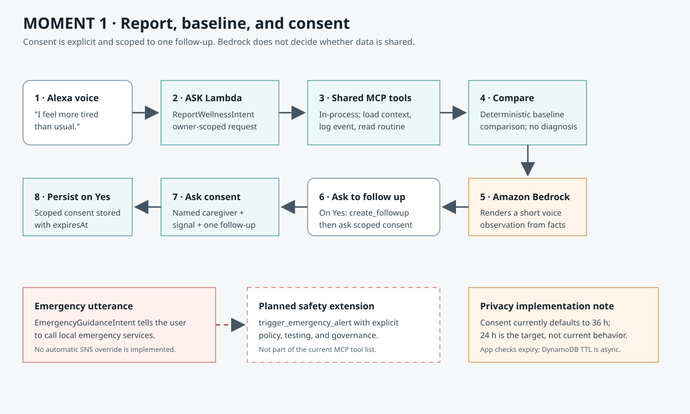
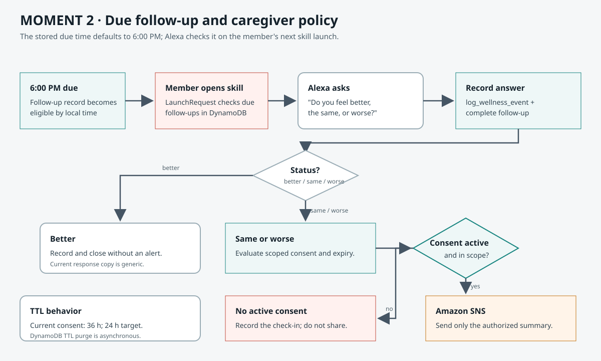
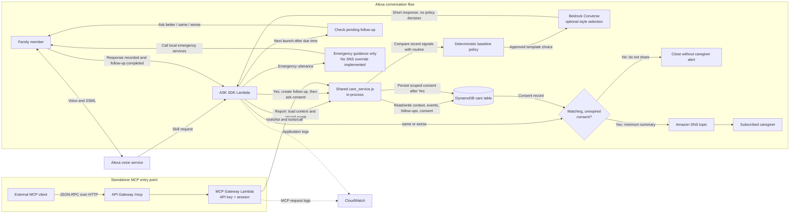

# CarePulse — MCP — AI-Assisted Health Tracking & Proactive Agentic Care

**CarePulse turns voice-reported wellness changes into a consent-gated follow-up workflow, using Alexa, AWS services, and the Model Context Protocol (MCP).**

[](https://aws.amazon.com/bedrock/)
[](https://developer.amazon.com/en-US/alexa/alexa-skills-kit)
[](https://modelcontextprotocol.io/)
[](https://aws.amazon.com/dynamodb/)
[](https://aws.amazon.com/sns/)
[](#technology-and-scope)
[](#team-and-hackathon)

> [!IMPORTANT]
> **Hackathon demo scope.** Use synthetic records and trusted demo clients. `CARE_MODE=demo` explicitly enables the demo identities and shared MCP key. Bedrock never grants consent or authorizes disclosure. The shared service now revalidates persisted consent, the completed follow-up, and the caregiver binding before publishing, including direct MCP calls. Production onboarding, Alexa+ account linking, and public privacy/terms documents are outside this demo iteration.

## Executive Summary

Older adults and people managing ongoing health concerns can experience reporting fatigue. They may also hesitate to involve family caregivers if sharing feels broad, permanent, or outside their control.

**CarePulse MCP** is a voice-first family wellness orchestration skill for Alexa. It records everyday wellness signals, compares recent reports with a member's configured routine, and offers scheduled follow-ups. Before a caregiver can receive a conditional summary, Alexa requests explicit, sequential consent for a named caregiver, a specific signal, and one follow-up. If the member reports feeling the same or worse at that check-in, the application verifies that consent is still active before publishing a minimal, authorized alert through Amazon SNS.

CarePulse is not a medical device, does not diagnose, and is not an emergency service. The current emergency intent directs the user to local emergency services; it does not send an emergency SNS alert.

## Voice Conversation: Judge Demo

The interaction model is `en-US`. This is the representative seeded Elena/Laura conversation contributed by the team. The seed creates two recent tiredness reports and three nights of sleep below Elena's 7.5-hour baseline, so the example observation has supporting demo data. The dialogue below is illustrative; current wording uses deterministic observations and approved templates selected by Bedrock when available. Consent and follow-up turns are driven by the application handlers.

You can also say "list my check-ins", "cancel my check-in", "move my check-in to eight PM", "no, I slept seven hours", "tell me the details", or "turn discreet mode on". If more than one check-in is pending, CarePulse asks for its number before changing or completing one. A follow-up moved to a new time loses its previous sharing permission. Discreet mode hides wellness details on cards and screen snapshots; the demo starts with it off so judges can see the data, while production contexts default to on. Outbound SNS text stays generic in either mode.

```text
Elena: Alexa, open CarePulse.
Alexa: Welcome to CarePulse. You can tell me how you feel, ask for a wellness
  summary, or schedule a check-in. How can I help?

Elena: I feel more tired than usual.
Alexa: I found similar tiredness reports and sleep below your usual routine. This is a
  change worth following up on, not a diagnosis. Would you like to
  check in again at 6 PM?
Elena: Yes.
Alexa: The check-in is saved for the stated date at 6 PM. Open Care Pulse again
  then to answer; I will not call you automatically. Do you authorize Laura
  to receive a brief alert if you report tiredness as the same or worse at
  this follow-up? Permission lasts up to 36 hours and can be withdrawn.
Elena: Yes.
Alexa: Done. Your permission applies only to this follow-up, and no other
  information will be shared with Laura.

Later, after the follow-up is due, Elena opens CarePulse again:

Alexa: Elena, we planned to check how you were feeling. Do you feel better,
  the same, or worse?
Elena: I feel the same.
Alexa: Thank you. I recorded the follow-up. The notification service accepted
  the alert for Laura. I cannot confirm delivery or that it was read.
```

Without an SNS topic configured, the final response instead says the authorized alert was prepared but the notification service is unavailable, and asks the user to contact Laura directly. If the user answers **better**, CarePulse records the follow-up and does not alert the caregiver. If the user declines consent, the follow-up can remain scheduled but no wellness details are shared.

For the emergency-safety demo, say **“I have chest pain”** or **“I cannot breathe.”** The current `EmergencyGuidanceIntent` tells the user to call local emergency services; it does not invoke SNS or bypass consent.

## Engineering Case Study

### Moment 1: Report, Baseline, and Scoped Consent

1. The member reports a wellness signal, such as unusual tiredness or reduced sleep.
2. The Alexa ASK SDK handler derives a pseudonymous owner key, loads the member's care context, records the event, and calls `compare_with_baseline`.
3. The current comparison is deterministic: it looks for repeated signals and sleep below the stored routine. It describes an observed change without diagnosing.
4. When configured, AWS Bedrock selects an approved voice template within a bounded timeout. The application supplies the facts; free-form model output cannot change them.
5. Alexa asks whether to create a follow-up. It then asks whether the member authorizes a named caregiver to receive a brief alert only if the same signal is reported at that follow-up. The consent record is written only after an affirmative response.



**Red-flag behavior:** `EmergencyGuidanceIntent` recognizes emergency language such as chest pain or difficulty breathing and tells the user to contact local emergency services. The proposed `trigger_emergency_alert` consent override is **not implemented**; no automatic SNS alert bypasses consent in the current release. See the target tool specification below.

### Moment 2: Scheduled Follow-up and Caregiver Decision

The default follow-up is stored for 6:00 PM in the member's configured time zone. At or after that time, the next Alexa skill launch checks for a due follow-up and asks whether the member feels better, the same, or worse.

- **Better:** the response is recorded, the follow-up is completed, and no caregiver alert is sent. Current voice copy is a neutral acknowledgement; “I'm glad you're feeling better” is a proposed copy improvement, not the exact current response.
- **Same or worse:** the policy checks the completed follow-up and a matching, unexpired, signal-scoped consent. If consent is missing or expired, the event is recorded but not shared. If the policy allows sharing, the application sends a short summary through SNS.



> [!NOTE]
> This prototype does **not** wake Alexa or initiate a check-in at exactly 6:00 PM. It evaluates the due follow-up when the member opens the skill after its due time. A true outbound proactive check-in would require an additional supported scheduling and Alexa Proactive Events design, user permissions, and delivery testing.

## MCP Toolset Specification

The following six names describe the original target tool contract. The repository now exposes twelve MCP tools; deployment acceptance remains separate. The demo contract uses `ownerId` rather than `user_id`.

| MCP tool (target) | Input parameters (target contract) | Purpose and infrastructure backend | Current implementation |
| :--- | :--- | :--- | :--- |
| `get_care_context` | `user_id` | Retrieve care context, routine, caregiver, and relevant history from DynamoDB. | Implemented under this name; input is `ownerId, memberName`. |
| `log_wellness_event` | `user_id, symptom, state, ttl` | Record a wellness event in DynamoDB. | Implemented; input is `ownerId, memberName, signal, state` plus optional details. New events expire after the configured retention period, default 90 days. |
| `compare_with_baseline` | `current_event, baseline_data` | Compare recent signals with the member's routine; use structured results for the voice experience. | Implemented with deterministic logic using `ownerId, memberName, signal`; Bedrock only selects approved voice wording. |
| `store_scoped_consent` | `token, rules, ttl_24h` | Persist explicit, narrow permission with a 24-hour expiration. | Consent behavior is implemented as `request_consent`; current default expiry is **36 hours**, not 24. |
| `trigger_emergency_alert` | `user_id, alert_type` | Proposed red-flag override route to an emergency notification policy and SNS. | **Not exposed or implemented.** Emergency guidance only tells the user to contact emergency services. |
| `send_caregiver_alert` | `user_id, caregiver_id, summary` | Publish a minimum-data notification to the authorized caregiver through SNS. | Revalidates the persisted consent, completed result, and recipient binding. The external `authorized` argument is removed. An outbox claim prevents concurrent duplicate publication. |

### Tools Currently Returned by `tools/list`

The MCP catalog contains `get_care_context`, `log_wellness_event`, `get_wellness_history`, `compare_with_baseline`, `create_followup`, `request_consent`, `send_caregiver_alert`, `ingest_bee_context`, `list_followups`, `complete_followup`, `cancel_followup`, and `revoke_consent`. The Node.js JSON-RPC Streamable HTTP gateway negotiates `2025-11-25`, `2025-06-18`, or `2025-03-26`. Demo clients use `x-carepulse-mcp-key` and an initialized MCP session. Completion saves the result and any alert job atomically; it does not itself confirm notification delivery. Production mode requires a verified bearer access token and a server-side identity/profile binding; no identity provider is provisioned by this repository.

## Bee Wearable Ingestion (Preview)

> [!NOTE]
> **Preview.** CarePulse can receive Bee-derived context through MCP, gated by the member's voice consent, and show it on the Wellness Snapshot card. The included bridge script (`scripts/bee_bridge.js`) reads Bee data on the member's computer through Bee's local developer proxy and sends it in the input format below; there is no hosted Bee connector yet.

### Flow

```
"Alexa, ask care pulse to link my Bee" ──► consent explained ──► "yes"
        │
        └─► link code shown only in the Alexa app card (stored as a SHA-256 hash, expires in 30 days)

Bee app ──► Bee CLI / API ──► caller maps data ──► MCP tools/call ingest_bee_context { linkCode, beeExport }
        │
        └─► link + consent verified ──► wearer-only text ──► signals (no transcripts) ──► DynamoDB (provenance: bee)

"Alexa, give me my wellness summary" ──► voice summary + Wellness Snapshot card (Bee 🐝 badge on screens)
"Alexa, ask care pulse to unlink my Bee" ──► "yes" ──► consent revoked, link code invalid, Bee signals deleted
```

1. **Consent by voice.** `LinkBeeIntent` explains what is used, what is stored, the 30-day duration (`BEE_CONSENT_DAYS`), and how to stop. Only a "yes" creates the consent and the link code; the code is never spoken aloud.
2. **The link code decides whose data is written.** `ingest_bee_context` takes `linkCode`, not `ownerId`, so an MCP caller cannot write Bee data into an arbitrary member. Linking again invalidates the previous code.
3. **Wearer-only analysis.** Bee also records other people. Only utterances marked `speaker: "wearer"` and facts with `confirmed: true` are analyzed; Bee conversation summaries are ignored because they mix speakers. The response reports what was ignored.
4. **Derived signals only.** Tiredness, sleep, mood, appetite, dizziness, and discomfort are detected from wearer wording; intensity remains unspecified unless the wording supports it. Common negated or third-party clauses are ignored. Optional `healthKit.sleepHours` is compared with the member's baseline. No Bee text is stored. Re-sending the same export (same `exportedAt`) is skipped, and Bee events expire after 90 days through `expiresAt`.
5. **Revocation deletes data.** `UnlinkBeeIntent` revokes consent, invalidates the code, and deletes every Bee-derived event while keeping voice reports.

### Input format (CarePulse contract)

```json
{
  "linkCode": "ABCD-2345",
  "beeExport": {
    "exportedAt": "2026-10-09T18:00:00Z",
    "facts": [{ "text": "I felt completely exhausted after lunch", "confirmed": true }],
    "conversations": [{
      "utterances": [
        { "speaker": "wearer", "text": "I am very anxious about the appointment" },
        { "speaker": "other", "text": "This is ignored" }
      ]
    }],
    "healthKit": { "sleepHours": 5 }
  }
}
```

Response: `{ success, eventsIngested, signalsDetected, skipped, ignored: { unconfirmedFacts, otherSpeakerUtterances }, errors }`.

### Testing with a real Bee account

`scripts/bee_bridge.js` reads the member's data from the local Bee proxy and sends it to CarePulse. It has no dependencies (Node.js 22+), never prints spoken text, and only sends confirmed facts and lines spoken by the wearer.

1. **Deploy this branch** and rebuild the interaction model so `LinkBeeIntent` and `UnlinkBeeIntent` exist. Note the MCP endpoint URL (ending in `/mcp`) and the `MCP_API_KEY`.
2. **Link Bee by voice.** In the Alexa Developer Console (Test tab) or on an Echo, say "ask care pulse to link my Bee" and answer "yes". Copy the code from the **CarePulse Bee link** card in the Alexa app (or the console's card output).
3. **Start the Bee proxy.** Enable Developer Mode in the Bee iOS app (tap the app version five times), then:
   ```
   npm install -g @beeai/cli
   bee login
   bee proxy
   ```
   Keep this terminal open and note the URL it prints.
4. **Find your speaker label** (in a second terminal):
   ```
   node scripts/bee_bridge.js --bee-url <proxy-url> --list-speakers
   ```
5. **Preview, then send:**
   ```
   node scripts/bee_bridge.js --bee-url <proxy-url> --wearer-speaker <your-label>
   CAREPULSE_MCP_KEY=<key> node scripts/bee_bridge.js --bee-url <proxy-url> --wearer-speaker <your-label> --mcp-url <endpoint>/mcp --link-code <code> --send
   ```
   On Windows PowerShell, set the key first with `$env:CAREPULSE_MCP_KEY="<key>"`. Re-running is safe: already-sent items are skipped.
6. **Check the result.** Say "ask care pulse for my wellness summary". On a screen device the Wellness Snapshot card shows a Bee 🐝 badge on Bee-derived signals.
7. **Clean up.** Say "ask care pulse to unlink my Bee" and answer "yes" to revoke consent and delete Bee-derived signals.

If Bee returns a shape the bridge does not recognize, it stops and asks for `node scripts/bee_schema_report.js <file.json>`, which prints field names and types only, never values.

### Known limitations

- The bridge runs on the member's computer because Bee's proxy is local and for development only. There is no hosted Bee connector or Alexa account linking yet.
- Bee does not document its conversation schema. The bridge finds `utterances` anywhere in a conversation and uses `speaker` labels; verify with `--list-speakers` before sending. Only the first page of facts and conversations is read.
- Bee's API does not document sleep or health data; `healthKit.sleepHours` must come from another source.
- Signal detection is English keyword matching and does not handle negation ("not tired").
- The MCP API key is still shared; the link code limits which member a caller can write to, not who may call.

## Privacy Blueprint and Security

### Consent Expiration and DynamoDB TTL

The DynamoDB table enables TTL on the numeric `expiresAt` attribute. Consent checks also compare `expiresAt` with the current time before allowing a disclosure, so an expired record is denied by application policy even if DynamoDB has not physically deleted it yet.

**Consent lasts at most 36 hours.** MCP sessions expire after one hour. New voice, follow-up-result, seeded, and Bee events use `WELLNESS_RETENTION_DAYS` (default 90, allowed 1–365). Expired events are excluded from history before asynchronous DynamoDB TTL deletion finishes. Existing records without TTL, care contexts, follow-ups, alert jobs, backups, and other metadata still need a separate production retention/migration policy. Bee consent defaults to 30 days. The care table is retained on stack deletion and has point-in-time recovery enabled.

### Minimum Disclosure and Operational Boundaries

- Caregiver alerts contain a generic request to check in. Their subject and message contain no member name, signal, wellness history, or sleep metrics.
- Consent is scoped to the member, caregiver, signal, and follow-up. A `same` or `worse` response alone is insufficient to authorize sharing.
- Alexa user IDs are hashed into an owner key outside demo mode. `DEMO_OWNER_ID` deliberately overrides that isolation for a repeatable hackathon seed; do not use a shared demo owner for unrelated real users.
- Runtime logs emit aggregate metrics and a Lambda correlation ID, without member names, owner IDs, report bodies, consent IDs, or raw dependency errors.
- DynamoDB server-side encryption and point-in-time recovery are enabled. SNS uses a retained customer-managed KMS key with scoped publisher permissions. The HTTP MCP endpoint requires an API key and compares it in constant time.
- The shared API key is a demo credential. Set `DEMO_OWNER_ID` to constrain both ASK and MCP to one synthetic household; without it, trusted demo MCP clients may choose fixture owners. Every alert path rechecks stored consent and the completed follow-up. Production mode rejects shared keys and requires an identity binding, active member access, and storage consent; its full onboarding and Alexa+ integration are still pending.
- SNS acceptance confirms that SNS accepted a publish request; it does not prove that a caregiver received or read the notification.

> [!IMPORTANT]
> Public privacy/terms documents and production identity-provider setup are deliberately deferred for the hackathon. They are not marked completed in the improvement plan. A real-data release needs its own eligibility, consent, retention, security, and deployment review.

## Architecture and Repository Layout

```text
.
|-- serverless.yml                         # AWS functions, HTTP API, table, topic, IAM
|-- skill-package/
|   |-- skill.json                         # Alexa skill manifest
|   `-- interactionModels/custom/en-US.json # Voice intents and slot types
|-- lambda/
|   |-- index.js                           # Alexa Lambda entry point
|   |-- alexa_handlers.js                  # ASK request handlers
|   |-- care_service.js                    # Shared wellness and consent rules
|   |-- care_repository.js                 # DynamoDB and local storage adapter
|   |-- mcp_tools.js                       # MCP tool catalog
|   |-- voice_agent.js                     # Bedrock voice rendering
|   |-- voice_copy.js, voice_format.js     # English voice copy and formatting
|   |-- care_dashboard.js, apl/            # Optional ASK screen dashboard
|   |-- mcp_http.js                        # MCP JSON-RPC HTTP gateway
|   |-- sns_notifier.js                    # Caregiver notifications
|   |-- seed_demo.js                       # Hackathon demo data
|   `-- test/                              # Node.js test suite
|-- infrastructure/cfn-deployer/           # CloudFormation deployment assets
|-- docs/                                  # Architecture diagrams
|-- assets/logos/                          # Project marks
`-- ask-resources.json                     # Alexa build/deployment resources
```

Alexa handlers and the MCP HTTP server currently live together under `lambda/`; `alexa_skill/` and `mcp_server/` are conceptual components, not repository directories. The implementation is Node.js/CommonJS. Python and TypeScript are not runtime dependencies; they are not represented as implemented technology by the badge above.

## Runtime orchestration

The deployment has two independent entry points. Alexa invokes its ASK SDK Lambda, which calls the shared MCP tool implementations **in-process**. External MCP clients instead use the HTTP API and MCP gateway Lambda; Alexa does not call that gateway. Both paths use the same DynamoDB table and tool implementation code.



**Important timing detail:** the follow-up is stored with a due time (default 6:00 PM in the member's time zone). No Lambda schedule or Alexa proactive event wakes the user at that time. The next skill launch after the due time prompts for a status. A `better` response closes without an alert; `same` or `worse` proceeds to the Alexa-side consent policy, and SNS is called only if that policy allows sharing.

Bedrock is optional and uses the Converse API to select approved wording within a default 1.2-second timeout. Deterministic copy remains available on timeout, invalid output, or service failure. It does not decide urgency, consent, or alert delivery. CloudWatch retains logs for 14 days. DynamoDB uses on-demand billing, point-in-time recovery, server-side encryption, TTL on `expiresAt`, and a retain-on-stack-removal policy. Consent currently expires after 36 hours by default; DynamoDB TTL cleanup is asynchronous.

> [!WARNING]
> The shared key is available only in explicit demo mode. Persisted consent is checked inside the shared alert service. A bearer-token verification foundation is present for a future production deployment, but successful local tests do not establish an operational Alexa+ account-linking integration.

## Quickstart and Deployment

### Prerequisites

- Node.js 22 or newer and npm.
- AWS CLI v2 authenticated to the target AWS account.
- Serverless Framework 4 (`npx serverless@4` is used below).
- An Alexa custom skill in the Alexa Developer Console and its Skill ID.
- Optional access to a Bedrock Converse-compatible model, with its exact allowed resource ARNs.
- An authorized caregiver email or phone number for the SNS subscription test.

Python 3.10+ and the ASK CLI are not required by this repository's current runtime or deployment path. The skill interaction model is uploaded through the Alexa Developer Console.

Verify AWS credentials and install/test the Lambda package:

```sh
aws sts get-caller-identity
npm ci --prefix lambda
npm test --prefix lambda
```

The `npm test` command runs all suites: conversations, MCP contracts, persistence, time zones, dependency failures, infrastructure configuration, and the SDK v3 vitals adapter.

### Environment and Deployment Parameters

The complete reference, including accepted values, defaults, required settings, and which variables are local-only or stack-managed, is in [Environment configuration](docs/environment-configuration.md). In particular, `CARE_MODE=demo` is the Serverless default for this hackathon stack; use `CARE_MODE=production` only with the separate production prerequisites described there. `CARE_STORAGE_MODE=memory` is for table-free local demos and is not forwarded to deployed Lambda functions.

| Setting | Source / purpose |
| :--- | :--- |
| `AWS_REGION` | Fallback for Serverless `--region`; defaults to `us-east-1`. AWS SDK clients use the deployed Lambda region. |
| `CARE_TABLE_NAME` | Set from the `CarePulseTable` CloudFormation resource. The code does not use `DYNAMODB_TABLE_NAME`. |
| `BEDROCK_MODEL_ID` | Optional `bedrockModelId`; uses deterministic wording when absent or unavailable. |
| `BEDROCK_RESOURCE_ARNS` | Fallback for `bedrockResourceArns`: exact comma-separated model/profile ARNs allowed for the Alexa role; supply when enabling Bedrock. |
| `OPERATIONS_ALARM_TOPIC_ARN` | Fallback for `operationsAlarmTopicArn`: optional operations SNS topic for CloudWatch alarm actions. |
| `SNS_TOPIC_ARN` | Shared demo topic from `CaregiverAlertsTopic`. Subscribe only intended hackathon test recipients: SNS delivers to every subscriber. Production delivery requires a separate verified recipient registry and topic allowlist; the demo topic is not used as a production fallback. |
| `MCP_API_KEY` | Demo gateway secret. Supply this variable, the `mcpApiKey` parameter, or `CAREPULSE_MCP_KEY`; a blank `MCP_API_KEY=` does not select the alias. |
| `ALEXA_SKILL_ID` | Supply this variable or the required `alexaSkillId` parameter for the Alexa trigger and SDK validation. |
| `MCP_ALLOWED_ORIGINS` | Optional comma-separated allowed browser origins; fallback for `mcpAllowedOrigins`. |
| `VOICE_TIMEOUT_MS` | Optional model response timeout; fallback for `voiceTimeoutMs`, default `1200`. |
| `DEFAULT_MEMBER_NAME`, `DEFAULT_CAREGIVER_NAME`, `DEFAULT_TIME_ZONE` | Fallbacks for `defaultMemberName`, `defaultCaregiverName`, and `timeZone`; retain Elena, Laura, and America/Mexico_City defaults. |
| `DEFAULT_BASELINE_SLEEP_HOURS` | Fallback for `baselineSleepHours`; applies only to the explicitly configured demo owner. Empty by default; the previous `8.0` default is retained as a comment in the environment reference. |
| `DEMO_OWNER_ID` | Optional synthetic household in explicit demo mode; also constrains MCP calls to that owner. Rejected outside demo mode. |
| `CARE_MODE` | Supported template values: `demo` and `production`. Serverless defaults to `demo`; a direct runtime invocation without it follows the non-demo path. Demo mode is rejected when `STAGE` is `prod` or `production`. |
| `CARE_STORAGE_MODE` | Optional local-only value `memory` permits demo storage without a table. AWS Lambda always requires `CARE_TABLE_NAME`; Serverless does not forward this variable. |
| `WELLNESS_RETENTION_DAYS` | Integer 1–365 for new wellness events and request deduplication records; default 90 days. |

The root `.env` and `.env.example` contain a deployment reference alongside the existing local settings. Keep existing local values when updating either file. For a new checkout, copy `.env.example` to `.env` only if `.env` does not already exist. Fill `ALEXA_SKILL_ID` and `MCP_API_KEY`; leave optional Bedrock values empty or configure both the model ID and exact resource ARNs.

For separate environments, keep a complete configuration in `.env.dev`, `.env.qa`, or `.env.prod` and select it with `--stage dev`, `--stage qa`, or `--stage prod`. These files are ignored by Git; only `.env.example` is versioned. Serverless v4 loads dotenv files automatically, and the explicit `env:` fallbacks in this service expose only the selected settings to Lambda. See the [Serverless environment-variable documentation](https://www.serverless.com/framework/docs/guides/variables/env-vars).

Deploy from the repository root after filling the selected environment file:

```sh
npx serverless@4 deploy --stage dev
```

Existing deployment parameters remain supported and take precedence over the new environment fallbacks. The example below uses shell variables for explicit overrides; dotenv loading inside Serverless does not expand a shell's `$CAREPULSE_MCP_KEY`. Export that shell variable first if using this form:

```sh
npx serverless@4 deploy \
  --stage dev \
  --region us-east-1 \
  --param="alexaSkillId=amzn1.ask.skill.REPLACE_ME" \
  --param="mcpApiKey=$CAREPULSE_MCP_KEY" \
  --param="bedrockModelId=YOUR_BEDROCK_MODEL_ID" \
  --param="bedrockResourceArns=YOUR_EXACT_MODEL_OR_PROFILE_ARNS" \
  --param="demoOwnerId=hackathon-demo"
```

After deployment:

1. Read the CloudFormation outputs `AlexaLambdaArn`, `McpEndpoint`, `CarePulseTableName`, and `CaregiverAlertsTopicArn`.
2. In Alexa Developer Console, open your custom skill and confirm its Skill ID matches the `alexaSkillId` deployment parameter.
3. Under **Build → Interaction Model → JSON Editor**, paste the contents of `skill-package/interactionModels/custom/en-US.json`, save, and build the model. Confirm the locale is **English (US)** and the invocation name is **care pulse**. Enable the `Alexa.Presentation.APL` interface to test the optional dashboard on supported devices.
4. Under **Build → Endpoint**, select **AWS Lambda ARN** for the skill's endpoint region and paste `AlexaLambdaArn`. Save the endpoint.
5. Open **Test**, switch the test stage to **Development**, and enable testing for the development version of the skill. Use the Alexa simulator input to send the utterances below; the test tab invokes the deployed Lambda, so AWS credentials, Bedrock model access, and the deployed resources must already be valid.
6. Subscribe the authorized test caregiver to `CaregiverAlertsTopicArn`. Confirm the email subscription before running the notification scene.
7. Keep the returned MCP session ID and send it on later requests. Every MCP request must include the `x-carepulse-mcp-key` header.

### Smoke Test in Alexa Developer Console

This is the actual ASK SDK conversation flow, split into setup and a later check-in. In **Test → Development**, enter phrases without the wake word. Use seeded demo data and start before 6:00 PM in the configured time zone so the follow-up is due that day.

| Console input | What the handler does | Expected next response |
| :--- | :--- | :--- |
| `open CarePulse` | Starts the custom Alexa Skill. | Welcome prompt. |
| `I feel more tired than usual` | `ReportWellnessIntent` records the signal and compares it with recent reports and routine. | Deterministic observation with approved wording, then asks whether to check in at 6 PM unless suggestions are off. |
| `Yes` | Confirms the follow-up and creates it for 6:00 PM. | Confirms the schedule, then asks whether Laura may receive a narrowly scoped alert. |
| `Yes` | `AMAZON.YesIntent` stores consent for that signal and follow-up only. | Confirms the scope of permission. |

The two `Yes` answers have different meanings: the first creates the follow-up; the second grants permission to share a matching future check-in. After the due time, open a **new skill session**:

| Console input | What the handler does | Expected next response |
| :--- | :--- | :--- |
| `open CarePulse` | `LaunchRequestHandler` finds the due follow-up. | Asks whether Elena feels better, the same, or worse. |
| `I feel the same` | `CompleteFollowupIntent` records the answer and evaluates the scoped consent. | Sends the brief alert if SNS accepted the publish; without SNS delivery, asks the user to contact Laura directly. |

The simulator does not advance Lambda's clock. For the normal demo, start before 6:00 PM and return after it. For an accelerated integration test, a trusted test operator can create a test-only follow-up due a few minutes ahead with the authenticated MCP `create_followup` tool, wait until it is due, and reopen the Skill. Do not use production member data.

To verify the no-alert branch, repeat with a test identity, decline the second permission question, and complete the due check-in; or answer `I feel better` after a consented check-in. Try `Give me my wellness summary` to test `GetWellnessSummaryIntent`.

### Voice and screen preferences

The ASK skill supports English (US) preference commands: `use short summaries`, `use detailed summaries`, `set my follow up time to eight PM`, and `turn off follow up suggestions` (`turn on follow up suggestions` restores them). Summary length changes spoken detail; the card still contains the full summary. The preferred time applies to newly created follow-ups when the user does not specify a time. Turning suggestions off leaves reporting and explicit follow-up requests available. The current MVP stores these preferences in the member context.

On an APL-capable device, an explicit summary request includes a simple dashboard with the latest report from the last 30 days, the next stored follow-up, and the active permission for the default caregiver on that follow-up. The summary remains fully usable by voice without APL. The interface is declared in `skill-package/skill.json`; enable it in the Developer Console as well if updating the skill there manually. This dashboard is part of the ASK experience, not a registered Alexa+ MCP App UI. See [Amazon's ASK APL integration guide](https://developer.amazon.com/en-US/docs/alexa/alexa-presentation-language/use-apl-with-ask-sdk.html).

If the Skill does not respond as expected, verify that the interaction model built successfully, the `AlexaLambdaArn` and region are correct under **Build → Endpoint**, and the stage is **Development**. Then inspect the `alexaSkill` Lambda logs in CloudWatch. Voice remains available without Bedrock. Inspect `VoiceFallbacks` to diagnose optional model failures.

Initialize the MCP protocol session (replace the endpoint and key with deployment values):

```sh
curl -i "$CAREPULSE_MCP_ENDPOINT" \
  -H 'content-type: application/json' \
  -H 'accept: application/json, text/event-stream' \
  -H "x-carepulse-mcp-key: $CAREPULSE_MCP_KEY" \
  --data '{"jsonrpc":"2.0","id":1,"method":"initialize","params":{"protocolVersion":"2025-11-25","capabilities":{},"clientInfo":{"name":"carepulse-demo","version":"1.0.0"}}}'
```

The response includes `Mcp-Session-Id` and the negotiated protocol version. Send `notifications/initialized` before calling tools, and include the session and `Mcp-Protocol-Version` headers on subsequent requests. History results now contain `events`, `period`, and `nextCursor`; follow the cursor for additional pages. See [the MCP contract and operations guide](docs/development-operations.md#mcp-contract).

### Seed Demo Data

The seed script creates recent tiredness and sleep reports, Elena's routine, and Laura as caregiver. It does **not** create consent; the member must grant it in the voice interaction.

```sh
cd lambda
CARE_TABLE_NAME="YOUR_CAREPULSE_TABLE_NAME" \
CARE_MODE="demo" \
DEMO_OWNER_ID="hackathon-demo" \
AWS_REGION="us-east-1" \
npm run seed:demo
```

> [!NOTE]
> A live proactive 6:00 PM voice prompt and the emergency SNS override are future work. The current judge demo simulates the later interaction by reopening the skill after the stored due time.

## Tests and Operations

See [development changes and operations](docs/development-operations.md) for the request budget, comparison rules, index backfill, role permissions, metrics, and notification failure procedure.

Run the suite:

```sh
npm test --prefix lambda
```

Tail the Alexa Lambda logs:

```sh
npx serverless@4 logs --function alexaSkill --stage dev --region us-east-1 --tail
```

Package without deploying:

```sh
npx serverless@4 package \
  --stage dev \
  --region us-east-1 \
  --param="alexaSkillId=amzn1.ask.skill.REPLACE_ME" \
  --param="mcpApiKey=$CAREPULSE_MCP_KEY" \
  --param="bedrockModelId=YOUR_BEDROCK_MODEL_ID" \
  --param="bedrockResourceArns=YOUR_EXACT_MODEL_OR_PROFILE_ARNS"
```

To remove the compute stack after the event, use `npx serverless@4 remove` with the same stage, region, Skill ID, MCP key, and Bedrock model parameters used during deployment. The DynamoDB table is retained; review and delete it separately only when retention requirements permit.

## Technology and Scope

- **Implemented:** Alexa ASK SDK v2, Node.js 22, AWS SDK for JavaScript v3, Amazon Bedrock Converse, Amazon DynamoDB, AWS SNS, MCP Streamable HTTP.
- **Not implemented in this repository:** Python services, TypeScript services, a separate `alexa_skill/` or `mcp_server/` package, 24-hour consent expiry, an SNS emergency override, or an autonomous scheduled Alexa push.
- **Current consent expiry:** 36 hours by default. Change the implementation and tests before claiming a 24-hour policy in a release.
- **Current alert rule:** only a `same` or `worse` follow-up with matching active scoped consent can reach `send_caregiver_alert`.

## Team and Hackathon

Built by **Vicente, Ethel and Emmanuel** for **Build, Ship, Shape: Amazon Developer Hackathon**. CarePulse MCP is a hackathon candidate project; this README does not claim an award or production medical certification.
